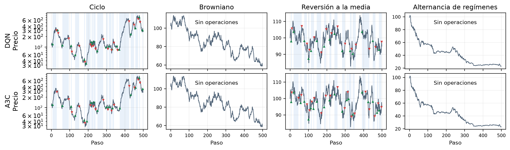

# DQN y A3C para invertir en un activo

**Josep Peréz Segura · Emilio Sanchez Martínez · Natalia San José Ortega**

## 1. Diseño y evaluación

Comparamos DQN, Doble DQN, DQN en duelo, A3C y REINFORCE en cuatro mercados simulados. El agente observa la tendencia de seis precios y su posición, y decide vender, mantener o comprar, con comisión del 0,1%. Cada episodio usa 500 precios nuevos. Se normalizan tendencia y recompensa sin discretizar el estado. DQN usa redes de 64×64, buffer de 100.000 experiencias, lotes de 64 y red objetivo cada 1.000 pasos; A3C, actor y crítico separados y cuatro trabajadores.

El ajuste inicial utiliza tres semillas; selecciona parámetros y pesos con 100 series de validación. El test principal usa otras 100 series y diez semillas nuevas de entrenamiento. **G es la suma de recompensas; no equivale a la rentabilidad porcentual.**

## 2. Resultados del experimento principal: test

| Agente | Ciclo | Browniano | Reversión | Regímenes | Convergencia en G: ciclo / reversión |
|---|---:|---:|---:|---:|---|
| Aleatorio | +456 (3,11) | −14,7 | −15,2 | −23,9 | — |
| Buy & hold | +3.425 (6,38) | +0,7 | −1,1 | −20,4 | — |
| Momentum | +48.189 (7,71) | −11,8 | −28,7 | −18,4 | — |
| Contrarian | −92,9 | −14,3 | +6,9 | −22,6 | — |
| DQN | +59.363 (8,13) | 0 | +22,1 (0,25) | 0 | 50 / 375 ep. ≈ 7 / 49 s |
| Doble DQN | +59.363 (8,13) | 0 | +21,0 (0,24) | 0 | 50 / 350 ep. ≈ 7 / 47 s |
| DQN en duelo | +60.723 (8,18) | 0 | +22,2 (0,25) | 0 | 50 / 375 ep. ≈ 8 / 61 s |
| A3C | +63.619 (8,21) | 0 | +27,5 (0,30) | 0 | 50 / 3.200 ep. ≈ 2 / 130 s |
| REINFORCE | +59.905 (8,24) | 0 | +28,5 (0,30) | 0 | 75 / 1.350 ep. ≈ 3 / 48 s |
| Q-learning (taller ant.) | +64.989 | 0 | +22,0 | +1,7 | 2.600 / 3.300 ep. ≈ 24 / 30 s |
| Sarsa (taller ant.) | +67.861 | 0 | +22,2 | +4,7 | 600 / 3.700 ep. ≈ 4 / 29 s |
| Oráculo (techo) | +1.193.433 (11,16) | +0,7 (0,09) | +77,3 (0,62) | +26,2 (0,26) | — |

Mediana del retorno (%) en 100 series de test; G media entre paréntesis y diez semillas por agente RL. Las referencias tabulares usan las mismas series. Su criterio de convergencia se basa en mediana del retorno; con ese criterio, DQN necesita 400 / 375 episodios y A3C 1.425 / 3.200. El ciclo sintético no representa una expectativa financiera real.

**Cuándo compran y venden.** En ciclo, compran cuando la tendencia positiva supera su umbral de entrada y venden cuando se vuelve suficientemente negativa; entre ambos límites mantienen la posición para evitar comisiones. En reversión, compran tras caídas pronunciadas y venden tras el rebote. En los ejemplos de browniano y alternancia de regímenes no compran: permanecen en efectivo al no identificar una señal suficientemente favorable. Las decisiones usan solo la tendencia reciente y la posición, sin conocer precios futuros.

**Figura 1.** ▲ verde: compra; ▼ rojo: venta; azul: periodo invertido. Filas: DQN y A3C; columnas: los cuatro mercados. Misma serie por mercado, semilla 100 y serie de test 0, sin seleccionar por rendimiento; mejor control de validación. Ciclo en escala logarítmica. Ambos operan en ciclo y reversión y permanecen fuera en los otros dos ejemplos. Es una trayectoria ilustrativa, no el resultado agregado de la tabla; no se fuerza venta final.

<!-- pagebreak -->

## 3. Estrategias, convergencia y pruebas complementarias

En ciclo aprenden seguimiento de tendencia con una banda de inacción; en reversión, compras tras caídas y ventas tras rebotes. Los métodos de actor mejoran al tabular en reversión, pero las redes no mejoran claramente ciclo y pierden el pequeño margen de regímenes. El oráculo de reversión, con información adicional, logra G≈0,63 frente a 0,25–0,30: sugiere estudiar estados más informativos, sin atribuir toda la diferencia al estado.

DQN y A3C alcanzan el criterio de convergencia sobre G en ciclo en 50 episodios (≈7 y 2 s). En reversión necesitan 375 y 3.200 (≈49 y 130 s); alcanzar el criterio no implica estabilidad posterior. Usar el último control en vez del mejor reduce el test de DQN de 22,1% a 2,6% y el de A3C de 27,5% a 15,9%. A3C sigue oscilando con 12.800 episodios.

**Pruebas adicionales.** MSE/MAE no ofrece ventaja clara con tres semillas. En DQN, una pasada por episodio completo logra 24,4% en reversión, frente al 22,1% con minibatches; 16 pasadas bajan a 10,8%, compatible con sobreajuste. Un cerrojo en el paso de Adam corrige estadísticas compartidas inconsistentes en A3C, manteniendo asíncronos los gradientes: su peor semilla mejora de 5,3% a 25,2%. Pasar de uno a cuatro trabajadores reduce el tiempo de la prueba de 57 a 23 s; ocho aportan poco más.

**Datos reales.** Entrenamiento hasta 2015, validación 2016–2018 y test desde 2019, en S&P 500, IBEX, cartera mixta y bonos. Ningún agente supera a buy & hold en el test realizado. En S&P 500: A3C≈190%, DQN≈179%, buy & hold≈193%; DQN presenta menor caída máxima (25% frente a 34%). Una historia por activo no permite generalizar.

## 4. Mejoras de estabilidad en reversión: validación

**DQN.** Con 400 episodios, se probaron aprendizaje decreciente y copias de la red objetivo cada 500, 1.000 o 2.000 pasos. Se confirmó reducir solo α de 0,002 a 0,0006 durante la segunda mitad, conservando copia cada 1.000 pasos y exploración original. La tabla resume cinco semillas nuevas; R_final es la media de medianas por serie del último control, G_final la ganancia media del último cuarto, oscilación su desviación temporal y brecha la diferencia mejor–último retorno.

| Confirmación DQN | Original | α decreciente |
|---|---:|---:|
| G_final / oscilación | 0,1331 / 0,0749 | 0,2168 / 0,0397 |
| R_final / brecha | 6,28% / 18,39 pp | 18,13% / 5,88 pp |

G_final y R_final mejoran en **5 de 5 semillas**; oscilación −47% y brecha −68%, con ≈42 s en ambas variantes. El mejor retorno apenas cambia (24,66% frente a 24,01%): se conserva mejor lo aprendido. **Falta un test independiente de esta mejora.**

**A3C.** Con 12.800 episodios y tres semillas, reducir solo α al 10% eleva G_final de 0,2156 a 0,2550 y baja la oscilación de 0,0519 a 0,0147; reducir solo entropía o ambos logra G_final=0,2492 y 0,2525. Con 3.200 episodios y entropía original, los calendarios constante / 10% / 30% dan G_final=0,2378 / 0,1955 / 0,2328; oscilación=0,0529 / 0,0079 / 0,0374 y R_final=16,09% / 12,72% / 16,58%. Ninguna reducción conserva G y retorno mientras reduce oscilación. Se mantiene A3C original, se repite con cinco semillas y solo esa configuración pasa al nuevo test reservado: 26,67% con el mejor control y 16,17% con el último. No demuestra superioridad de un calendario alternativo.

## 5. Hiperparámetros con más semillas

En reversión se repiten la configuración inicial y dos alternativas por algoritmo: **seis configuraciones × cinco semillas nuevas = 30 entrenamientos**, con las mismas 100 series de validación. A3C inicial (3.200 episodios, MAE, 20 pasos) mantiene 30,58% frente a 30,83%; las alternativas de 800 episodios logran 26,27% (MAE, 20 pasos) y 23,42% (MSE, 5 pasos). DQN inicial (α=0,002, γ=0,5, MSE) obtiene 16,08%; la alternativa α=0,0001, γ=0, MSE logra 21,93%, pero su ventaja de 5,85 pp tiene intervalo bootstrap [−4,93; +16,71]. Con α=0,002, γ=0,5 y MAE logra 18,00%, también sin ventaja clara.

Se exigían intervalo positivo y ventaja mayor que el máximo de 1 pp y el 5% de la media de referencia: **se mantienen ambas configuraciones**. En DQN es una decisión prudente ante la incertidumbre, no una demostración de superioridad.

## 6. Conclusión

Los agentes aprenden estrategias coherentes con los mercados: seguimiento de tendencia en ciclo y compras tras caídas en reversión, donde A3C y REINFORCE superan a DQN en el test principal. Sin embargo, entrenar más no garantiza conservar una buena política: conviene seleccionar los pesos mediante validación. Reducir el aprendizaje mejora la estabilidad final de DQN en cinco semillas nuevas; en A3C, suavizar la curva no basta para mejorar el rendimiento. La repetición con más semillas evita sustituir configuraciones por ventajas inciertas. **El siguiente paso es evaluar la mejora de DQN en un test independiente.** Las pocas semillas, la validación reutilizada, los intervalos sin corrección por comparaciones múltiples y la comisión fija limitan las conclusiones; no se demuestra una ventaja general en mercados reales.
